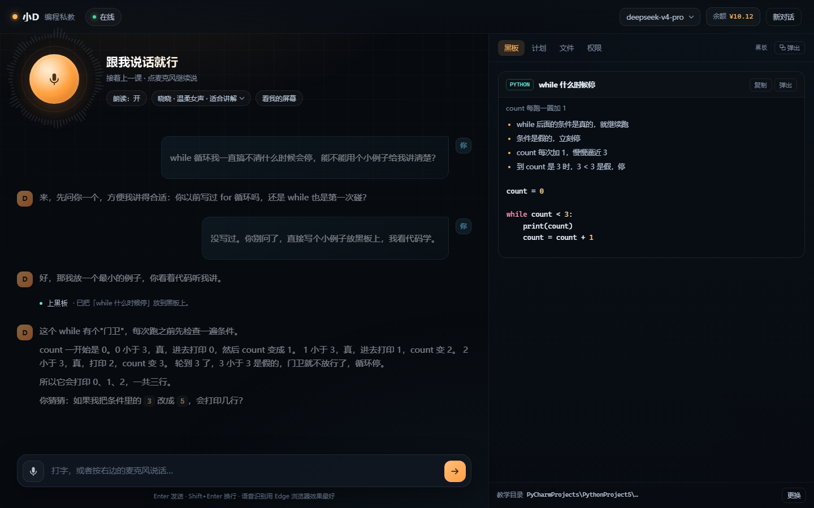

# 小D · dsh-tutor

**一个跑在自己电脑上的语音 AI 编程私教。它会等你、会动手，动手前先问你。**

不是又一个"套壳 ChatGPT"：它把「教学节奏」写进了系统提示，把「操控电脑」做成了一次一授权的工具调用，把「黑板」做成了能钉在桌面上的独立窗口。



---

## 它和普通 AI 编程助手有什么不同

| | 普通助手 | 小D |
|---|---|---|
| 回答问题 | 一次给完整代码 | **一次只走一小步，结尾必须留一个问题** |
| 你的水平 | 不知道 | 先问、再判断、卡住时按提示阶梯给线索 |
| 动手 | 复制粘贴 | 直接改你 PyCharm 里的文件、跑你的命令 |
| 权限 | 全有或全无 | **每次动手都要你点头**，可长期白名单 |
| 形式 | 聊天框 | 语音对话 + 桌面黑板 + 看你屏幕 |

## 功能

- 🎙 **常开麦克风**：点一次开始，说完一句自动断句发送，再点才关。识别在本地（faster-whisper），不联网。
- 🗣 **中文语音讲解**：Edge TTS 六个音色（晓晓/云希/云健…），云端不可用时自动退回系统语音。
- 🧑‍🏫 **教学人格**：`prompts/teacher.md` 定义"一次一步、不直接给答案、提示分三级、说完留钩子"。
- 🖥 **真·动手**：读文件、改代码、跑 PowerShell、在 PyCharm 里打开并定位、截屏 + 本地 OCR 看屏幕。
- ✋ **授权模型**：写文件/跑命令/看屏幕要点头；可「本回合允许」或「以后这个目录都允许」；删除/格式化/关机这类命令**永不自动放行**。
- 📋 **黑板**：右侧面板实时显示代码和要点；点「弹出」变成**桌面置顶独立窗口**，压在 PyCharm 旁边。
- 🔁 **接着上一课**：对话、黑板、计划都存在本地，刷新或重启后继续。

## 快速开始（Windows）

前置：**Node.js 18+**；建议装 **ffmpeg**（语音转码用，装完在 PATH 里即可）。

```powershell
git clone https://github.com/gaoming-lgtm/dsh-tutor.git
cd dsh-tutor

# 一次性安装：嵌入式 Python 3.11 + 离线识别 + 可选 Edge TTS
powershell -ExecutionPolicy Bypass -File setup.ps1

# 填 Key（二选一）
#   1) 编辑 config.json 里的 "apiKey"
#   2) 或者设置环境变量 DEEPSEEK_API_KEY

start.cmd
```

> 国内网络克隆慢的话，可以用 Gitee 镜像：<https://gitee.com/gaoming1232026/dsh-tutor>

启动后会自动用 Edge 打开一个带 token 的地址，例如：

```
http://127.0.0.1:7842/?t=...
```

> token 每次启动都变，别收藏旧链接。服务只监听 `127.0.0.1`。

## 用法

**说话**：点麦克风 → 一直开着 → 说完一句停顿约 0.8 秒自动发送 → 再点关闭。
它自己说话时会暂停录音，避免自问自答。

**黑板**：右侧三栏（黑板/计划/文件/权限）。点「弹出」得到桌面置顶窗口，内容实时同步。

**看屏幕**：点「看我的屏幕」，它截屏并用 Windows 本地 OCR 读文字，把图贴回对话。

**权限**：授权卡片三档——允许一次 / 本回合都允许 / 以后都允许。
右侧「权限」标签里可以逐条撤销，或点「一键课堂模式」把当前目录 + 常用命令 + 看屏幕设为免问。

**PyCharm**：打开网页时若检测到 PyCharm 项目，会提示「切到这个项目」。之后写入文件会自动在 PyCharm 里打开并定位到改动行。

## 架构

```
┌────────────┐    SSE / JSON     ┌──────────────────────────┐
│  Browser   │ ◄───────────────► │  server.mjs (localhost)  │
│ 语音/黑板  │                   │  agent loop + tools      │
└────────────┘                   └───────┬──────────┬───────┘
                                         │          │
                              ┌──────────▼──┐   ┌───▼──────────────┐
                              │ DeepSeek API│   │ 本机能力          │
                              │ (你的 Key)  │   │ PowerShell/OCR/IDE│
                              └─────────────┘   │ TTS/STT (Python)  │
                                                └───────────────────┘
```

- 对话：`POST /api/chat`（SSE 流式）
- 黑板：`/api/board` + `/api/events`（独立窗口订阅）
- 语音：`/api/tts`（Edge TTS）、`/api/stt`（faster-whisper，本地）
- 工具：`lib/tools.mjs`；权限：`lib/allowlist.mjs`；IDE：`lib/ide.mjs`

## 安全模型

- 服务只绑定 `127.0.0.1`，所有请求要带启动时生成的 token cookie。
- 文件操作被限制在教学目录内（路径越界直接拒绝）。
- 写文件/执行命令/截屏都要人工确认；白名单只按「目录 / 命令前缀」放行。
- 删除、格式化、改注册表、关机、强推等命令**永远要确认**。
- 没有遥测，不上传对话；会话存在 `data/sessions/`。

> 它确实能在你的电脑上执行命令。**只在你信任的机器上、只对着你信任的模型用。**
> 不要把带 token 的链接发给别人——那等于把电脑控制权交出去。

## 已知限制

- 仅 Windows（依赖 PowerShell、Win32、Windows OCR）。
- 模型没有视觉：屏幕内容是通过本地 OCR 变成文字给它的，图读不出来。
- 语音是「说完一句 → 合成 → 播放」，句间有 1–2 秒间隔，不是实时流式。
- 单用户、单机；没有多租户和计费。

## 项目结构

```
server.mjs            本地服务：静态页 + SSE 对话 + 工具执行 + 授权队列
prompts/teacher.md    教学人格（最值得改的文件）
lib/tools.mjs         工具定义（JSON Schema）
lib/allowlist.mjs     长期白名单 + 危险命令拦截
lib/ide.mjs           PyCharm / VS Code 探测与定位
lib/screen.ps1       截屏
lib/ocr.ps1          Windows OCR
public/               网页：对话、黑板、独立黑板窗口
stt/stt_worker.py     本地语音识别 worker
tts_worker.py         Edge TTS worker
setup.ps1             一次性安装
```

## English

**dsh-tutor** is a local, voice-first AI programming tutor for Windows. It runs on your machine, talks to you in Chinese via TTS, listens with on-device speech recognition, teaches one step at a time, and can edit files or run commands **only after you approve each action**.

Requirements: Node 18+, ffmpeg, a DeepSeek API key. Run `setup.ps1`, put the key in `config.json`, and start with `start.cmd`.

## License

MIT. See [LICENSE](LICENSE).

> 免责声明：本项目会调用系统命令、修改文件。作者不对任何数据丢失或系统损坏负责，使用前请备份并自行判断。
